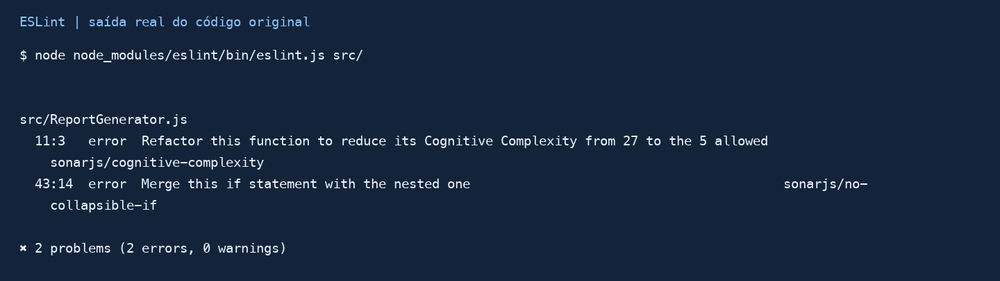

# 1. Análise dos Bad Smells

O arquivo original concentra seleção de itens, marcação de prioridade, formatação e soma dos valores no método `generateReport`. A análise manual identificou três problemas principais:

- **Método longo e complexo:** o método reúne várias responsabilidades e tem complexidade cognitiva 27. Uma mudança de formato exige entender também os fluxos de permissão. Para testar uma regra isolada, é necessário percorrer a geração do relatório inteiro.
- **Condicionais aninhadas:** as decisões por ADMIN/USER e CSV/HTML se repetem dentro do laço. O aninhamento dificulta acompanhar quais itens entram no relatório e aumenta a quantidade de caminhos que os testes precisam verificar.
- **Duplicação de lógica:** a linha CSV e a soma do total aparecem nos dois perfis. Corrigir um desses trechos exige lembrar do outro, com risco de divergência de comportamento. Os testes precisam validar ambas as cópias para detectar inconsistências.

Também foram encontrados os números mágicos 500 e 1000. Na refatoração, constantes nomeadas tornam explícitos o limite de visibilidade de USER e o valor que define prioridade para ADMIN.

## Detecção automática: ESLint + SonarJS

A configuração recebida já utilizava `eslint:recommended` e `plugin:sonarjs/recommended`. Foram mantidas as regras de complexidade cognitiva, funções idênticas e ramos duplicados. O limite de complexidade permaneceu em 5, mais rigoroso que o valor 15 sugerido no enunciado.



*Figura 1. Imagem renderizada da saída real de `eslint src/`, com caminhos normalizados. O original apresenta dois erros: complexidade 27 acima do limite 5 e um `if` que pode ser combinado com o condicional interno.*

O SonarJS quantificou a complexidade e localizou o condicional aninhado. A duplicação foi identificada manualmente: não houve alerta específico de funções idênticas ou ramos duplicados. Assim, a análise automática complementa a leitura do código, sem substituir a interpretação das regras de negócio.

<!-- pagebreak -->

# 2. Processo de Refatoração

O problema mais crítico foi a concentração de responsabilidades em `generateReport`, com complexidade cognitiva 27. A nova implementação foi criada em `src/ReportGenerator.refactored.js`.

## Antes: decisões de perfil e formato entrelaçadas

Trecho representativo do método original, omitindo os demais ramos:

```javascript
for (const item of items) {
  if (user.role === 'ADMIN') {
    if (item.value > 1000) {
      item.priority = true;
    }
    if (reportType === 'CSV') {
      report += `${item.id},${item.name},${item.value},${user.name}\n`;
      total += item.value;
    }
    // Outro ramo para HTML; USER repete parte da lógica.
  }
}
```

## Depois: método principal coordena funções pequenas

```javascript
generateReport(reportType, user, items) {
  const formatter = FORMATTERS.get(reportType);
  const header = formatter?.header(user) ?? '';
  const { body, total } = createReportBody(formatter, user, items);
  return `${header}${body}${formatter?.footer(total) ?? ''}`.trim();
}
```

- **Extract Method:** `canViewItem`, `updatePriority` e `createReportBody` separam acesso, prioridade e montagem do corpo. O total é acumulado em um único lugar.
- **Decompose Conditional:** a condição de guarda ignora itens sem acesso e formatos desconhecidos, reduzindo o aninhamento.
- **Estratégias de formatação:** objetos CSV e HTML implementam `header`, `row` e `footer`. O fluxo comum chama essas operações sem repetir decisões de formato para cada perfil.

Foram preservados os limites USER <= 500 e prioridade ADMIN > 1000, a alteração de `item.priority` e o retorno vazio para formatos desconhecidos. Itens de USER não recebem destaque por prioridade.

## Correções prévias à rede de segurança

O fork recebido não satisfazia a premissa de todos os testes aprovados. Primeiro, o script do Jest precisou de `--experimental-vm-modules` para executar os imports ESM. Depois, passaram 4/5 testes: a linha HTML de ADMIN sem prioridade gerava `<tr >`, mas o teste esperava `<tr>`.

Foi feita uma correção mínima de duas linhas no original: o espaço passou a integrar o atributo opcional (`' style="font-weight:bold;"'`), e a abertura passou a usar `<tr${style}>`. Isso estabeleceu 5/5 testes aprovados. Essa exceção à preservação do original foi documentada; os testes fornecidos permaneceram intactos.

<!-- pagebreak -->

# 3. Validação e Resultados

Os testes originais permanecem em `tests/ReportGenerator.test.js`, diretório usado pelo repositório recebido. A cópia exigida foi criada em `__tests__/ReportGenerator.refactored.test.js`, alterando somente o import para a nova implementação.

Durante a refatoração, os testes foram executados após as mudanças. A validação final usa `npm test -- --runInBand` e `npm run lint`. As evidências podem ser reproduzidas com `npm run evidence`.

| Indicador | Original corrigido | Refatorado |
| --- | --- | --- |
| Complexidade de generateReport | 27 | 2 |
| Maior complexidade de uma função | 27 | 4 |
| Limite configurado no SonarJS | 5 | 5 |
| Erros de análise estática | 2 | 0 |
| Testes da suíte fornecida | 5/5 | 5/5 |

**Resultado total: 33/33 testes aprovados em 3 suítes.** São 5 testes originais, 5 da cópia e 23 verificações adicionais de compatibilidade. Nenhuma regra foi desativada e nenhuma expectativa original foi alterada.

As verificações adicionais comparam a saída completa e as mutações dos itens em 21 combinações de 7 formatos e 3 perfis, incluindo formatos desconhecidos. Outros dois testes cobrem valores de fronteira (500/501 e 1000/1001) e chamadas sucessivas, preservando a prioridade de ADMIN e a ausência de destaque para USER.

## Evidências e reprodução

- `docs/evidencias/eslint-antes.txt` e `eslint-antes.json`: dois erros no código original.
- `docs/evidencias/eslint-depois.txt` e `eslint-depois.json`: zero erros na nova implementação.
- `docs/evidencias/testes-original.txt`: confirmação da rede de segurança inicial após as correções prévias.
- `docs/evidencias/testes.txt`, `testes.json` e `resumo.json`: aprovação das três suítes e métricas finais.

O comando `lint` aponta para o arquivo refatorado. Os comandos `lint:original` e `lint:all` continuam apontando os dois problemas de smell preservados no original para comparação. A medição detalhada de complexidade usa uma execução separada com limite zero para obter os valores de cada função; a configuração de aprovação continua com limite 5.

# 4. Conclusão

Os testes serviram como rede de segurança para reorganizar o código mantendo o comportamento coberto, inclusive seus efeitos sobre os itens. As verificações adicionais deram atenção aos limites e a situações não exploradas pela suíte fornecida. O resultado ficou mais fácil de ler e modificar: as regras de acesso, prioridade e apresentação têm responsabilidades explícitas, e o fluxo principal deixou de repetir decisões e somas.

A redução da complexidade de 27 para 2 no método principal e a ausência de erros de lint demonstram a melhoria estrutural. A aprovação dos testes sustenta a preservação do comportamento nos cenários verificados, sem representar uma prova sobre todas as entradas possíveis.

## Referências

- Enunciado da disciplina: *Detecção de Bad Smells e Refatoração Segura*, material fornecido.
- Projeto-base: https://github.com/CleitonSilvaT/bad-smells-js-refactoring
- SonarJS: https://github.com/SonarSource/eslint-plugin-sonarjs
- Jest 29.7, ECMAScript Modules: https://jestjs.io/docs/29.7/ecmascript-modules
- Catálogo de refatoração de Martin Fowler: https://refactoring.com/catalog/
